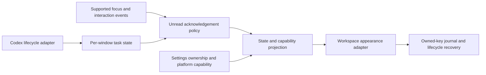

# Appearance architecture review

Date: 2026-10-18. Tested on macOS, VS Code 1.142.0.

## Decision

Keep supported workspace theme colors as the candidate for full-bar rendering **only when the appearance settings file is exclusive to that window**. A complete rewrite of event routing/state handling is not justified by the appearance prototype. Keep the appearance adapter independently testable and require rendered acceptance checks before installing further behavior changes.

This is a qualified feasibility result, not certification of the complete installed extension. The prototype does not exercise Codex, production IPC, crash recovery, native title bars, or physical mouse clicks. It is deliberately excluded from the VSIX and has not replaced the installed extension.

## Independent experiment

Run `npm run prototype:appearance`. Source is in `prototype/appearance/`. It imports no production modules and has no Codex bridge, watchdog, settings-ownership registry, diagnostics service, or automatic synchronization retries. A small fixture controller selects idle/processing/approval/finished; an independent workspace-color adapter paints it. Focus return acknowledges finished only. Processing/approval never acknowledge merely through focus.

All projects, profiles, extension copies, control files, and the empty `CODEX_HOME` are temporary. The harness opens two windows with different folders in one disposable profile, then a third window on the same folder using a second disposable profile. This last case permits the exact same settings file to be observed in two actual desktop windows. No personal chats, credentials, or project files are used.

The test-only renderer connection reads computed backgrounds and captures screenshots. Assertions use the expected custom baseline colors, including theme-specific active/inactive colors. They do not infer success from settings values or sample a potentially unfinished color transition as the reference baseline. Fixture coordination uses temporary files; production code does not use that control mechanism.

## Results

The completed run passed **62 rendered checks** across Dark Modern and Light Modern. Full evidence: [appearance-prototype.json](evidence/appearance-prototype.json).

| Scenario                                        | Observed result                                                   |
| ----------------------------------------------- | ----------------------------------------------------------------- |
| A processing, B idle                            | A blue, B retains its custom baseline                             |
| Focus B while A processes                       | Both status and custom title in A stay blue                       |
| A waiting for approval; focus B and return to A | A stays amber throughout                                          |
| A completes while focused                       | Purple initially persists                                         |
| Focus B after A completes                       | A stays purple and remains finished                               |
| A completes while unfocused                     | A becomes purple without taking focus                             |
| Return to A                                     | A restores its custom active colors; B is unaffected              |
| A amber while B processes/completes             | A remains amber while B independently becomes blue/purple         |
| Return to B                                     | B alone acknowledges its completion                               |
| Status-only/title-only                          | Selected surface changes; the other surface restores its baseline |
| Restore after an unrelated user color edit      | Baseline returns and the edit survives                            |
| A and idle C share one settings file            | Both render A's blue, although C's fixture state remains idle     |

Screenshots from the same run: [A amber](evidence/prototype-A-amber.png), [B purple while unfocused](evidence/prototype-B-purple.png). These are captures of the disposable renderer, not generated mockups.

The shared-file experiment is an expected negative result. It demonstrates that the workspace-color adapter cannot make the two windows independent. It must reject shared ownership or restore/pause coloring. It must never silently advertise independent full-bar colors for that case. A separate small status item can remain window-specific but does not satisfy the requested large visual signal by itself.

The production-source two-window fixture test was then extended with the same amber focus assertions. It passed actual rendered checks for blue, amber while unfocused, amber after returning to A, amber after focusing B again, purple while unfocused, and restoration. Both state and rendered color remained correct. [Production-source acceptance evidence](evidence/production-appearance-acceptance.json) is separate from the independent prototype evidence. This validates the current appearance implementation under fixture lifecycle events; it still does not exercise an authenticated Codex approval request or physical mouse clicks.

## Alternatives considered

| Mechanism                                 | Assessment                                                                                                                                                                                    |
| ----------------------------------------- | --------------------------------------------------------------------------------------------------------------------------------------------------------------------------------------------- |
| Workspace `workbench.colorCustomizations` | Full status/custom-title colors through supported settings; persistent, asynchronous, and shared by windows reading the same settings file. Validated for distinct settings files.            |
| Global/profile color settings             | Couple unrelated project windows. Rejected for activity rendering.                                                                                                                            |
| Public `StatusBarItem`                    | Per-window item; cannot color the full bar. Background API supports warning/error item colors, not an arbitrary full-width blue/purple/amber surface. Rejected as the primary interface.      |
| Renderer CSS/DOM injection                | Could bypass settings scope, but requires private access and maintenance across VS Code updates. Rejected for production. The debugger is used only in disposable tests to observe rendering. |
| Native floating overlay/helper UI         | Adds window identification, platform permissions, and external UI behavior. Not established by this experiment and not selected as an implicit replacement workflow.                          |

Sources: [VS Code theme colors](https://code.visualstudio.com/api/references/theme-color#status-bar-colors), [settings scopes and persistence](https://code.visualstudio.com/docs/configure/settings), [StatusBarItem API restrictions](https://code.visualstudio.com/api/references/vscode-api#StatusBarItem), and the tested build's [inactive status-bar rendering](https://github.com/microsoft/vscode/blob/6d62b1d5dace93a33b3a6d3eca1317bd5e15bcb1/src/vs/workbench/browser/parts/statusbar/statusbarPart.ts#L661).

## Boundaries for the production design

- Retain process-to-window routing and the pure per-thread reducer as candidates. Their lifecycle contract is independent of coloring; this prototype supplies no new evidence that the experimental Codex bridge is stable across updates.
- Keep acknowledgement in per-window state/policy. The appearance adapter accepts the resulting state and a surface. It must not infer completion, decide acknowledgement, or clear amber on blur.
- Treat exclusive settings ownership as an explicit capability. Shared settings pause the full-bar adapter; do not reopen the user's project or create a workspace wrapper.
- Define the palette contract over every relevant surface: active/inactive status backgrounds, debugging/no-folder variants, active/inactive custom title backgrounds, readable foregrounds, and owned borders. Apply and restore theme-specific overrides too.
- Keep persistence, ownership, synchronization, and recovery behind the appearance adapter. Their complexity is partly imposed by the supported settings API. Removing recovery because the minimal prototype looks simpler would make crash behavior worse.
- Diagnostics observe behavior. Cross-window diagnostic probes do not determine activity, focus ownership, or acknowledgement.
- A rendered test must check both state and appearance. The earlier tests checked a correct active color while VS Code rendered a different inactive color, missing the actual bug.

## Before promoting a replacement adapter

Installation and activation are separate checks. A same-version reinstall can replace files while an existing extension host continues running its previously loaded code. Acceptance checks must reload the monitored windows and verify the loaded capabilities, rather than relying only on the package version or installed file contents.

The prototype is intentionally not production-ready: it lacks crash-safe journals/ownership, bounded write coalescing, configurable palette/contrast handling, and a real Codex source. Before replacing production code, the candidate adapter must pass the same rendered matrix plus actual disable/deactivation, extension-host crash/reload recovery, user edits to owned keys, rapid state changes, and real lifecycle/approval integration. Those checks must retain the distinct-settings capability boundary rather than claim that a rewrite can eliminate it.

The experiment supports a focused adapter refactor and stronger acceptance coverage. It does not support an unconditional claim that the complete plugin is fixed, or that all existing infrastructure should be discarded.
