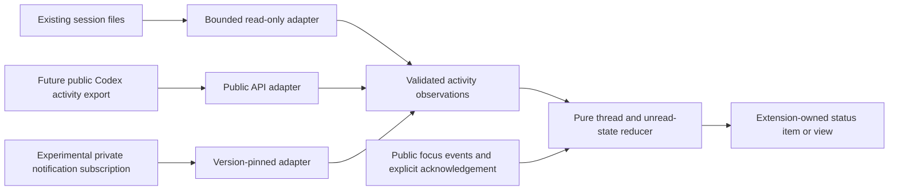

# Self-contained activity integration study

Studied October 24, 2026. This is a source-based architecture decision, not an
implemented replacement or a live compatibility certification.

Study status: **closed**. Read [STUDY-DECISION.md](STUDY-DECISION.md) for the final
bounded-gate result, capability table, and implementation recommendation.
Historical proposals and next steps below do not extend the completed study.

Follow-up: the [snapshot-only prototype](INTROSPECTION-PROTOTYPE.md) now verifies
closure access against the actual extension in an isolated VS Code profile.
It also identifies partial turn/approval caches and documents the remaining
blocking-input and lifecycle limitations. Statements below about untested real
access describe the earlier study stage; consult the prototype report for the
current evidence.

## Decision

The supported interfaces do not currently implement the exact original
experience under the strict self-contained requirement: automatic attribution
to each existing Codex window, accurate running/approval/input/completion states,
and arbitrary blue/amber/purple backgrounds in VS Code's existing chrome.

After the user clarified that version-specific maintenance is acceptable,
additional research found a plausible unsupported route: in-process inspection
of retained closures, followed by registration of an owned notification listener
on the existing connection. A synthetic closure-access probe passed. Actual
Codex/VS Code compatibility and failure isolation remain untested. See the
[introspection update](#introspection-update-personal-version-pinned-adapter).
The original blanket conclusion that only upstream changes could unlock live
observation was too categorical.

The user subsequently clarified that introspection is acceptable but modifying
external plugins/applications/services is not. Under that boundary the proposed
private listener registration is excluded: it inserts our callback into another
extension's runtime collection. The remaining introspection candidate is bounded
inspection of existing state. Full signal availability through reads alone has
not been demonstrated. This clarification supersedes the experimental listener
recommendations below, which remain recorded as research history.

A self-contained extension can display an independent indicator and, with an
explicitly selected compatibility mode, observe existing session files read-only.
That provides partial turn tracking. It cannot reliably supply approval state or
identify which of two windows sharing a project owns a conversation.

The recommended production boundary is an extension-owned UI and pure state
reducer behind a versioned activity-source interface. A future public, passive
API from the official Codex extension can supply full fidelity. Until that API
exists, a version-pinned, snapshot-only introspection adapter merits an isolated experiment.
Expose any file-based mode as partial observation; do not rebuild the old
full-feature claim around heuristics or process interception.

The earlier conclusion that Codex only exposes completion was too broad. Codex
has richer events internally. Their existence does not establish that another
extension can obtain them without changing Codex's execution or configuration.

## What self contained means here

Installing, activating, disabling, crashing, updating, or uninstalling this
extension must not determine whether Codex starts, runs tools, obtains approval,
or completes work. Neither application may need to call our code to proceed.

| Boundary      | Allowed                                                                                           | Excluded                                                                                                              |
| ------------- | ------------------------------------------------------------------------------------------------- | --------------------------------------------------------------------------------------------------------------------- |
| Files         | Bundled code; extension-owned storage/logs; bounded read-only observation of existing files       | Changes to Codex configuration, hooks, executables, authentication, transcripts, or databases                         |
| VS Code       | Public APIs for our own UI/storage; version-pinned private inspection research as described below | Method replacement, module interception, renderer injection, background-color allowlist edits, application patches    |
| Configuration | Our own `codexCompletion.*` preferences                                                           | `chatgpt.cliExecutable`, `notify`, hooks, appearance overlays, workspace wrappers, shared process environment changes |
| Processes     | None required for monitoring                                                                      | Codex proxies, extra app-servers, process attachment, signals, service installation, watchdogs, startup agents        |
| Failures      | Stop our observer and show unavailable/unknown                                                    | Restarting Codex or VS Code, automatic repairs to another application's state, delaying an agent operation            |

These are architectural guarantees about dependencies and mutations, not a
promise of literally zero resource use. Any extension consumes CPU/memory and
uses an extension host. Bounded asynchronous work and public APIs reduce that
remaining risk; they cannot make all extension-host failures impossible.

## Versions and evidence

The references match the installed stack, rather than upstream development:

| Component           | Version/revision                                                                                                 |
| ------------------- | ---------------------------------------------------------------------------------------------------------------- |
| Codex               | `0.164.0-alpha.11.1`, commit `6905ecede7816e91373e9eabda3f6b0368fc747b`                                          |
| VS Code             | `1.143.1`, commit `e646868227c3e3a9e3f24277c8c7220be42c0be7`                                                     |
| Codex IDE extension | `26.1021.22027`, compiled host bundle SHA-256 `a9cc6736cd2c2d22f6cf43fc5763d5f8a873e4f741f522b44a600b1926f4e627` |

The IDE extension is a compiled distribution, not original source. For readable
inspection, a derived copy was written to ignored
`sources/analysis/extension-host.pretty.js`. Its relevant symbols are `iKt`
(activation), `H1.startCodexProcess`, `dWe` (process launch), and `sKt`
(chat-session provider registration). It can be regenerated without executing
the bundle:

```sh
mkdir -p sources/analysis
./node_modules/.bin/prettier sources/codex-extension/out/extension.js --ignore-path /dev/null > sources/analysis/extension-host.pretty.js
```

The public source citations below use immutable upstream revisions. Refreshing
`sources/` requires revisiting these conclusions; see [SOURCES.md](SOURCES.md).

### 1. The installed IDE extension exposes no activity API

Its module exports activation/deactivation functions. The activation function
constructs a private `H1` connection, starts Codex, and registers its own
notification handlers and chat-session provider. Activation returns no object
exposing that connection or an event stream. Internal provider-registration
methods are not exported for another extension to use.

VS Code supports deliberate extension-to-extension APIs through
[`Extension.exports`](https://github.com/microsoft/vscode/blob/e646868227c3e3a9e3f24277c8c7220be42c0be7/src/vscode-dts/vscode.d.ts#L8336),
but this installed Codex extension does not supply the needed API. Requiring its
bundle, reaching into its internals, or wrapping process/event functions would
reintroduce interception and is excluded.

### 2. The live states exist, but the IDE connection is private stdio

Codex's
[`ThreadWatchManager`](https://github.com/openai/codex/blob/6905ecede7816e91373e9eabda3f6b0368fc747b/codex-rs/app-server/src/thread_status.rs#L147)
tracks running turns, pending permission requests, and pending user-input
requests. It publishes `thread/status/changed`. These are the appropriate
authoritative signals for the original state machine.

The installed extension starts `app-server --analytics-default-enabled` with
piped stdin/stdout/stderr and no socket-listener argument. The server's
[transport selection](https://github.com/openai/codex/blob/6905ecede7816e91373e9eabda3f6b0368fc747b/codex-rs/app-server/src/lib.rs#L815)
creates a stdio connection in that mode; the Unix control-socket acceptor is a
different transport branch. The existence of socket support in Codex therefore
does not provide an observer endpoint for this IDE-owned process.

Starting a separate server does not give it this process's runtime state.
Changing the launch mode, replacing the executable, or splicing its pipes is
outside the required boundary. Do not attach to an unrelated daemon simply
because it happens to expose a socket.

Even a future shared-server approach needs careful separation of observation
from participation. Status changes are
[broadcast notifications](https://github.com/openai/codex/blob/6905ecede7816e91373e9eabda3f6b0368fc747b/codex-rs/app-server/src/thread_status.rs#L223),
whereas
[thread subscribers can receive server requests](https://github.com/openai/codex/blob/6905ecede7816e91373e9eabda3f6b0368fc747b/codex-rs/app-server/src/outgoing_message.rs#L174).
One concrete warning is the
[current-time request path](https://github.com/openai/codex/blob/6905ecede7816e91373e9eabda3f6b0368fc747b/codex-rs/app-server/src/current_time.rs#L142),
which rejects an ambiguous number of subscribers. This does not prove every
second connection breaks Codex; it disproves treating an ordinary additional
thread subscription as inherently side-effect-free. Do not use `thread/resume`
as a supposedly passive subscription shortcut.

### 3. Hooks are supported, but do not satisfy this requirement

Prompt, permission, stop, interrupt, and model-request hooks exist. Installing
them changes another application's configuration and makes Codex invoke our
helper. The
[hook dispatcher](https://github.com/openai/codex/blob/6905ecede7816e91373e9eabda3f6b0368fc747b/codex-rs/hooks/src/engine/dispatcher.rs#L117)
waits for synchronous handlers and schedules asynchronous handlers itself.
Permission handlers also
[participate in approval decisions](https://github.com/openai/codex/blob/6905ecede7816e91373e9eabda3f6b0368fc747b/codex-rs/hooks/src/events/permission_request.rs#L89).

The newer
[observation-only model-request hooks](https://github.com/openai/codex/blob/6905ecede7816e91373e9eabda3f6b0368fc747b/codex-rs/hooks/src/events/model_request.rs#L1)
ignore their output as control flow, but still require installation and helper
execution. A model request is also narrower than a whole turn. These hooks do
not solve strict containment, definitive waiting state, or window attribution.

The current version's user-level `notify` integration also falls outside the new
boundary. Keeping its helper inside extension storage does not make the external
configuration dependency self contained.

### 4. Existing session files support partial, passive observation

Codex's
[persistence policy](https://github.com/openai/codex/blob/6905ecede7816e91373e9eabda3f6b0368fc747b/codex-rs/rollout/src/policy.rs#L127)
retains `TurnStarted`, `TurnComplete`, and `TurnAborted` events. The same match
explicitly excludes `ExecApprovalRequest`, `RequestPermissions`,
`RequestUserInput`, `ElicitationRequest`, and patch-approval requests from durable
events. Tailing session files cannot reproduce the live waiting flags.

The
[wire definitions](https://github.com/openai/codex/blob/6905ecede7816e91373e9eabda3f6b0368fc747b/codex-rs/protocol/src/protocol.rs#L1517)
use legacy `task_started`/`task_complete` names and accept the corresponding
`turn_*` aliases. A parser must handle the actual stored format, not assume the
app-server notification format. Current
[completion records](https://github.com/openai/codex/blob/6905ecede7816e91373e9eabda3f6b0368fc747b/codex-rs/protocol/src/protocol.rs#L2273)
can include terminal errors; the reducer must not turn every terminal event into
a successful completion.

[Session metadata](https://github.com/openai/codex/blob/6905ecede7816e91373e9eabda3f6b0368fc747b/codex-rs/protocol/src/protocol.rs#L3256)
contains thread/session IDs, cwd, source, and workspace roots. It does not provide
the matching VS Code window identity. Filtering `source=vscode` can exclude
other sources but cannot distinguish two windows on the same project. A cwd
match establishes project relevance, not ownership. Focus is not proof of
ownership either.

File events are asynchronous and can lag the runtime. The
[recorder](https://github.com/openai/codex/blob/6905ecede7816e91373e9eabda3f6b0368fc747b/codex-rs/rollout/src/recorder.rs#L887)
can defer file creation, and its
[background writer](https://github.com/openai/codex/blob/6905ecede7816e91373e9eabda3f6b0368fc747b/codex-rs/rollout/src/recorder.rs#L1978)
processes persistence asynchronously. An unmatched start could represent work,
an approval wait, a crashed process, or missing/delayed records. Silence must
never manufacture completion or approval state.

Existing IDE logs are not a complete substitute: the inspected incoming-message
processor logs selected slow/large messages rather than every lifecycle event.
Enabling extra logging would change another extension's configuration and still
would not establish a public observation contract. Direct database polling is
not needed for the proposed file observer; avoid extra locking/schema/WAL
dependencies.

### 5. Rendering has its own independent limitation

The public status-item API allows our own text, icon, foreground, tooltip, and
command. However, the
[installed VS Code setter](https://github.com/microsoft/vscode/blob/e646868227c3e3a9e3f24277c8c7220be42c0be7/src/vs/workbench/api/common/extHostStatusBar.ts#L195)
rejects backgrounds outside its warning/error allowlist. Registering more colors
does not remove that restriction. The former private-map modification changes
extension-host state and is excluded even when it appears to work.

The
[proposed chat-session API](https://github.com/microsoft/vscode/blob/e646868227c3e3a9e3f24277c8c7220be42c0be7/src/vscode-dts/vscode.proposed.chatSessionsProvider.d.ts#L32)
lets providers register/manage their own sessions. It does not expose a public
collection of Codex's sessions for an unrelated extension to observe.

Safe choices today are a colored foreground/icon in our status item, a supported
warning background for a genuine input-needed state, or arbitrary blue/amber/
purple tiles inside our own webview view. Coloring the entire title/status bar
through persisted appearance settings, mutating shared warning/error theme
values, and padding an item to imitate an unrestricted background are excluded
as implementation strategies for the original palette.

## Candidate comparison

| Approach                                              | Strictly contained?                                                   | Signal quality                                       | Decision                                                              |
| ----------------------------------------------------- | --------------------------------------------------------------------- | ---------------------------------------------------- | --------------------------------------------------------------------- |
| Replace Codex executable / tee stdio                  | No                                                                    | Rich live events                                     | Reject; puts us back in the startup/execution path                    |
| Patch private VS Code/Codex objects                   | No                                                                    | May appear complete on one build                     | Reject; shared state and update fragility                             |
| Install hooks or `notify`                             | No                                                                    | Completion or richer callbacks                       | Reject under this requirement                                         |
| Start/resume through another app-server               | No established passive contract                                       | Does not automatically observe the IDE's process     | Reject for existing IDE sessions                                      |
| Read current session files only                       | Yes, with bounded reader and no external writes                       | Turn lifecycle; waiting and ownership are incomplete | Optional, explicitly partial mode                                     |
| Read another extension's logs/state                   | Read-only access alone is possible                                    | No complete lifecycle/window contract found          | Do not make this the primary adapter                                  |
| Version-pinned closure inspection plus owned listener | No external writes; transient inspector use and one internal listener | Potentially full live events in the same host        | Promising experimental route; not verified against the real extension |
| Future public Codex activity export                   | Fits if designed as passive data subscription                         | Full per-window state is possible                    | Preferred production route; unavailable in this build                 |

## Recommended architecture



There is no edge from this extension into Codex execution. For a public API
adapter, use an already active provider's exported API; do not force activation,
restart it, or make it an installation dependency just to obtain an indicator.
If the provider disappears, dispose the subscription and show unavailable.

For an optional file adapter:

1. Open existing session files with read-only access. Never create Codex home,
   acquire writer locks, update access/read state in a database, or repair files.
2. Use asynchronous, incremental reads with explicit per-read, per-line,
   per-scan, retained-thread, and pending-work limits. Bound directory discovery;
   avoid rescanning all historical chats on every event or in every window.
3. Isolate parsing in an extension-owned worker with bounded messages, memory
   limits, and a termination deadline. Do not load Codex's bundle/native code.
   This limits work in the extension host; it is not a complete process sandbox.
4. Handle partial records, truncation, replacement, missing directories,
   unsupported history layouts, and permission errors by degrading to unknown.
   Skip unsupported/compressed history rather than launching external tools.
5. Retain only IDs, source/cwd routing metadata, state, terminal outcome, and
   timestamps. Although the input contains conversation content, do not log,
   cache, display, or send that content. No network access is needed.
6. Describe a nonterminal turn as **turn open**, not proven active processing.
   Never infer approval from a tool call, elapsed time, or assistant text.
7. Offer project aggregation or an explicitly selected thread. If two windows
   select the same project/thread they may show the same result; do not claim
   automatic exclusive window ownership. Store selection only in our own data.
8. Establish an activation baseline; old completions are history, not new unread
   notifications. Duplicate suppression uses thread and turn IDs. Interruption,
   failure, and successful completion remain separate outcomes. Lost observation
   changes confidence to unknown rather than inventing a terminal result.
9. Keep completions until explicit acknowledgement by default. Acknowledgement
   changes our unread state only and never sends a command to Codex.
10. Disabling or disposing closes handles, watchers, timers, and workers.
    Nothing is installed to continue monitoring after the extension exits.

Own storage may contain preferences, a selected thread ID, bounded offsets, and
diagnostics. Avoid copying transcripts. If the observer cannot maintain its
limits, stop it and leave the editor and Codex running normally.

## What upstream support would unlock the full idea

The smallest useful change would be a documented, versioned export from the
official IDE extension: a current activity snapshot and a change event for the
threads associated with that extension host/window. This is a proposed contract,
not an API present in the inspected version.

It should include thread/turn identity, running and waiting flags, explicit
terminal outcomes, a generation/sequence for reconnect reconciliation, and clear
window ownership semantics. It should omit conversation text. Listener failures
must be contained by the publisher; subscriptions must neither acquire control
of requests nor keep threads alive. Snapshot/event ordering must close the
subscribe-versus-snapshot race.

That would solve observation without proxies, hooks, or changing the user's
workflow. The display would still need either the supported foreground/icon
design or our own view. The exact original chrome backgrounds require a separate
supported VS Code capability; an upstream Codex event API cannot solve that.

## Implementation and acceptance gates

The source study is complete. Runtime validation of a replacement has not been
performed. Before implementing a production replacement:

1. Decide explicitly between partial project/thread observation now and waiting
   for a public per-window provider. Do not promise the complete original
   experience for the partial adapter.
2. Prototype with synthetic files and a disposable VS Code profile. Test the
   boundaries before connecting any observer to personal sessions.
3. Test distinct projects, identical projects in two windows, nested folders,
   multiple threads, empty windows, reloads, sleep/resume, crashes, malformed/
   oversized/partial files, rotation/truncation, cancellation, and terminal errors.
4. Verify supported foreground/icon rendering, view disposal, manual
   acknowledgement, high-contrast themes, and observer/worker termination.
5. In isolated fixtures, assert that Codex/VS Code settings, executables, hooks,
   and workspace appearance files are unchanged. Compare with a baseline because
   the applications themselves legitimately write logs and session state.
6. Assert no spawned Codex/helper process, no network/server connection, bounded
   resource use, and prompt editor responsiveness while parsing adversarial files.
7. Inject observer faults and verify that the Codex process/turn continues.
   Uninstalling our extension must not require another application to find one
   of our files or run an undo procedure before starting successfully.

The existing notifier configuration is an external dependency left by the
current release. A future migration should report it and offer a deliberate,
separate removal action. Do not perform automatic cleanup or config rewriting
on activation. This study did not remove or alter the installed integration.

The original proxy's structural failure mode was making a persistent executable
override depend on extension-owned launch files. This study does not reconstruct
every historical failure. The new boundary removes that entire dependency,
including any need for startup repair or crash-recovery agents.

## Introspection update: personal, version-pinned adapter

Status after the user's subsequent clarification: the closure-reading mechanism
remains a research candidate; private listener registration is excluded. The
subscription proposal below is historical, not authorization to implement it.

The user's acceptance of ongoing maintenance separates two questions:
unsupported implementation details can be acceptable, while startup coupling,
configuration changes, and uncontrolled effects remain unacceptable. Public API
availability is therefore not the only useful feasibility criterion.

### A concrete route worth testing

The installed extension is CommonJS. VS Code's
[loader uses ordinary require](https://github.com/microsoft/vscode/blob/e646868227c3e3a9e3f24277c8c7220be42c0be7/src/vs/workbench/api/node/extHostExtensionService.ts#L188),
so the already loaded module may be reachable through the same extension host's
module cache. Ordinary JavaScript reflection stops at a function's closed-over
variables; the in-process V8 inspector can expose internal scope descriptors.
This does not require loading the Codex bundle a second time.

The source suggests this discovery path:

1. Inspect the already cached module's `deactivate` function (`oKt`).
2. Inspect its module closure to find retained cleanup function `DX`.
3. Inspect that cleanup function's activation closure for connection `v` and/or
   provider `S`. V8 can retain variables captured by sibling callbacks in the
   same activation context. Whether it does so in the actual VS Code build must
   be tested; static source alone cannot guarantee the path.
4. If the exact expected connection is reached, its
   `registerInternalNotificationHandler` method offers an existing notification
   subscription. `routeIncomingMessage` calls those handlers for notifications
   inside individual try/catch blocks, before forwarding notifications to its
   normal providers. The callback can observe `thread/status/changed` and
   `turn/completed` without becoming an app-server client or handling approvals.

The listener is an explicit, narrow mutation: adding our callback to the
connection's internal handler set, using its existing registration/disposal
method. It is not literally a read-only snapshot. It does not require replacing
methods, wrapping transports, modifying original handlers, or making Codex launch
through our files. The source's exception guard helps, but does not contain
blocking callbacks, resource exhaustion, or every inspector failure.

The chat-session provider's `lifecycleByConversationId` cache alone is
insufficient: the inspected implementation records started/completed/failed
states but does not implement needs-input state. Polling that map would repeat
the earlier fidelity problem. Observing the original notification stream is the
more promising path.

### What was actually proved

`sources/analysis/introspection-probe.cjs` creates an independent synthetic
CommonJS extension with a private connection retained in an activation context.
It reads that connection through `deactivate` and cleanup scopes using
`Runtime.evaluate` and `Runtime.getProperties`, releases its remote object group,
and disconnects. The probe passed on Node `24.14.1`; its output is saved locally
as `sources/analysis/introspection-probe-result.json`.

It opened no inspector port, used no breakpoints, did not enable the Debugger
domain, did not take a heap snapshot, and left the fixture's application state
unchanged. This proves the closure-discovery mechanism in a synthetic process,
not access to Codex's actual runtime or end-to-end event capture in VS Code.
Inspector object handles retain objects until released and inspection consumes
resources, so this is not a claim of zero runtime effects.

### Required boundaries for an experiment

- Run in a disposable VS Code profile with synthetic input first. Do not enable
  introspection in the user's installed profile as part of this research.
- Verify the extension version, bundle hash, host identity, and object layout.
  If any check fails, stop our adapter. Never fall back to a proxy or patch.
- Require both extensions to share an extension host. Remote/split-host cases
  are unsupported unless independently demonstrated.
- Use one short-lived in-process inspector session for discovery/registration;
  never open a port, pause execution, set breakpoints, take heap snapshots, scan
  the whole heap, or change process launch/debug settings.
- Read descriptors and an explicit allowlist of scopes/fields. Avoid invoking
  arbitrary getters or target methods while walking objects. The eventual
  listener-registration method is a separately reviewed, deliberate call.
- Keep the callback minimal, bounded, and exception-contained. Copy only
  lifecycle metadata into our bounded queue; do all heavier work later. Register
  no request/approval handlers and issue no Codex RPCs.
- Retain an owned disposal handle. Dispose on disable/reload and when discovery
  fails after registration. Release inspector handles in every exit path. Track
  an actual connection generation to avoid historical/reconnect false results.
- Test ordinary debugging alongside the observer, event ordering, queue
  saturation, process restart, extension reload, callback exceptions, and
  duplicate registration before considering personal-profile activation.

This candidate could make accurate live state and window-local observation
possible for a maintained personal plugin. It does not remove VS Code's
background-color restriction or justify private rendering mutations. Its
failure behavior must be measured before claiming it meets the containment
goal. There is still no implemented production introspection adapter.

## Clarified containment boundary: inspect existing data only

Acceptable version-specific research consists of finding already loaded objects
and reading existing data without changing the target's methods, listeners,
collections, configuration, installed files, or services. Our extension stores
its own observations and renders its own UI. Inspector discovery can have
runtime overhead and retain objects temporarily; release handles, bound work,
and test that overhead rather than claiming zero effects.

An internal listener registration does not modify installed source files, but
does modify the private handler set and adds our code to notification dispatch.
It therefore does not meet this clarified rule, even if disposable and guarded
against exceptions. Do not describe it as read-only introspection.

The next experiment must establish whether the existing host/renderer state
already retains all required status flags and reliable window/thread identity.
If it does, bounded snapshots may suffice. If it does not, inspection cannot
recover absent or already discarded events. Polling can also miss transitions
between samples. Missing information must remain unknown; it must not trigger a
fallback to listener injection, transport interception, or configuration changes.
